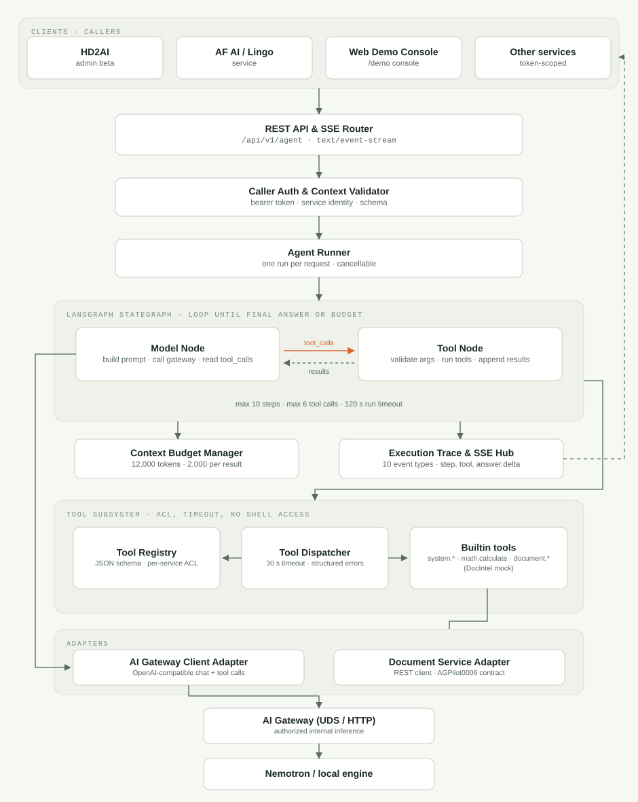
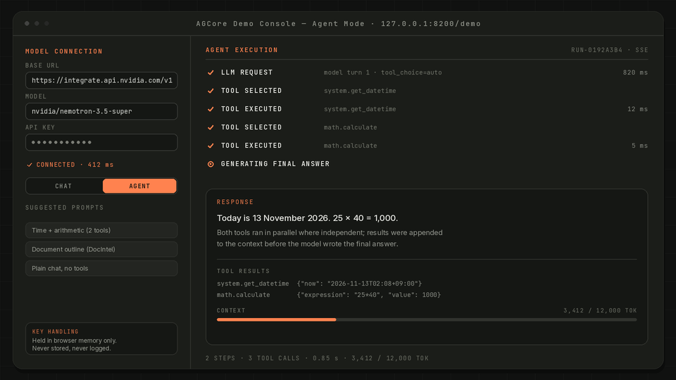

## Overview

HD2Lab Agent Core Platform (AGCore) is a standalone, universal agent runtime. It keeps the agent loop out of any single product: a calling service sends a request over REST or SSE, and AGCore decides whether a tool is needed, runs it, watches the context budget, and streams back each step as it happens.

The service is deliberately independent of the products that use it. Model inference is delegated to an authorized AI Gateway instead of being embedded in the runtime, so a caller can change models or engines without rewriting its agent logic, and the same runtime can serve an administrator console, a language service, or any other token-scoped internal client.

This profile describes the platform at an architecture level. The implementation source is kept in its own application repository and is not linked from TechnicalHub.

## Runtime Architecture

Requests enter through a FastAPI router that serves both JSON endpoints and a `text/event-stream` channel. A caller-auth and context-validation stage checks the service token, the service identity, and the request schema before a run is created.

The run itself is a LangGraph state graph with two working nodes:

- **Model Node** builds the prompt and available tool definitions, calls the AI Gateway, and reads the returned `tool_calls`.
- **Tool Node** validates the requested arguments, executes the selected tools, and appends each result to the message state before control returns to the model.

Independent read-only tools are dispatched concurrently, and a failing tool does not abort the run: the dispatcher returns a structured error object that the model can see and recover from, so a bad argument produces a corrected answer instead of a stack trace. The loop ends when the model answers without a tool call, when the step or tool-call ceiling is reached, when the run timeout expires, or when the client cancels.

A context budget manager sits beside the graph and trims or compresses older tool output as the run grows, while an execution trace hub records each event and relays it to the caller over SSE. Two adapters connect the runtime outward: an AI Gateway client for inference and a document service adapter for the Document Intelligence Service (AGPilot0006).

## Core Features

- **Autonomous tool calling.** Tools are declared in a registry with a JSON schema and a per-service allow-list. The dispatcher applies a per-tool timeout and a sandboxed execution boundary; the arithmetic tool parses expressions against an AST whitelist and never calls `eval()`, and no tool exposes OS commands or filesystem access.
- **Context budgeting.** A run starts with a 12,000-token budget, single tool results are capped at about 2,000 tokens with a truncation warning, older results are summarized, and repeated identical calls to idempotent tools are served from cache.
- **Real-time tracing.** Ten event types (`run.started`, `step.started`, `model.started`, `tool.started`, `tool.completed`, `step.completed`, `answer.delta`, `run.completed`, `run.failed`, `run.cancelled`) carry the execution state to the client. The stream reports what actually ran — selected tools, arguments, results, durations — and never exposes the model's internal reasoning.
- **Web demo console.** A bundled single-page console runs at `/demo/` against the same backend. It takes a Base URL, model name, and API key, switches between a plain chat call and a full agent run, shows the step-by-step viewer live, and can abort a run in progress.

## Demonstration

The view above is a rendering of the demo console's agent execution screen: a two-tool run in which the model asks for the current date and an arithmetic result, the dispatcher executes both, and the answer is composed from the returned results. It illustrates the console layout and the shape of the event stream rather than reproducing a specific recorded session; no live model credentials appear in any published asset.

The console keeps the API key in browser memory only. It is never written to storage, cookies, logs, or the event stream, and it disappears when the page is reloaded. The backend also rejects model base URLs that resolve to private address space or cloud metadata endpoints.

## Interfaces and Contracts

All endpoints are versioned under `/api/v1` and authenticated with a bearer service token plus a service identifier.

- `POST /api/v1/agent/runs` — create a run. The body carries `agent_id`, `message`, `session_id`, `stream`, and per-run options such as `max_steps`, `max_tool_calls`, and `temperature`; the response returns a `run_id` and status.
- `GET /api/v1/agent/runs/{run_id}` — status, final answer, trace summary, and usage counters.
- `POST /api/v1/agent/runs/{run_id}/cancel` — request cancellation of a running agent.
- `GET /api/v1/agents` — registered agents and their allowed tool lists.
- `GET /api/v1/health` — service status and gateway connectivity.

SSE frames follow one envelope — `event: <event_name>` followed by a JSON payload with `run_id`, `event_id`, `timestamp`, and a per-event `data` object — so a client can render progress without polling and can resume reading a run's events from its identifier.

## Privacy and Deployment

This profile publishes an architecture-level overview only: it does not reproduce implementation source, internal endpoints, credentials, or deployment configuration. Service tokens are required on every call and tool access is limited by the caller's allow-list, which keeps one service from borrowing another service's capabilities.

Because the runtime executes tools on behalf of other systems, the isolation boundary is explicit: tools run under per-call timeouts, the built-in tool set is deliberately small and side-effect free, and arbitrary code or shell execution is not part of the contract. Runs are bounded by step, tool-call, and wall-clock limits, so a misbehaving model cannot hold a worker indefinitely, and a cancellation request ends the run and emits a terminal event that the caller can rely on.
