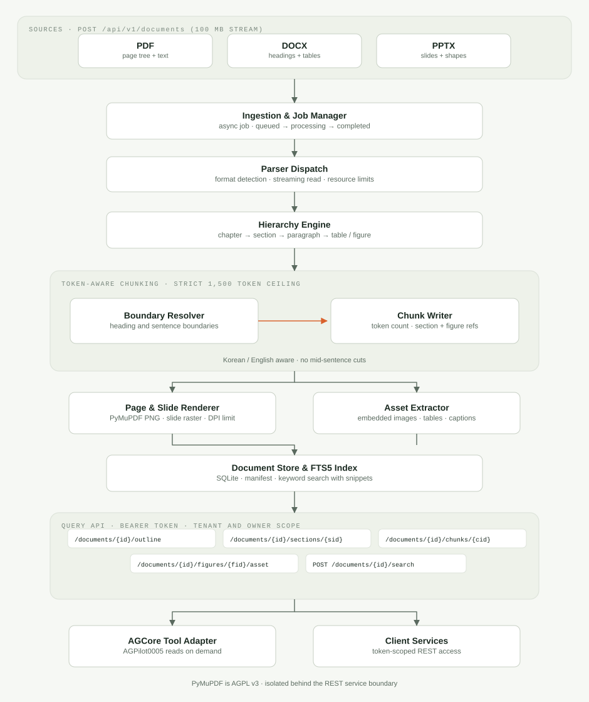
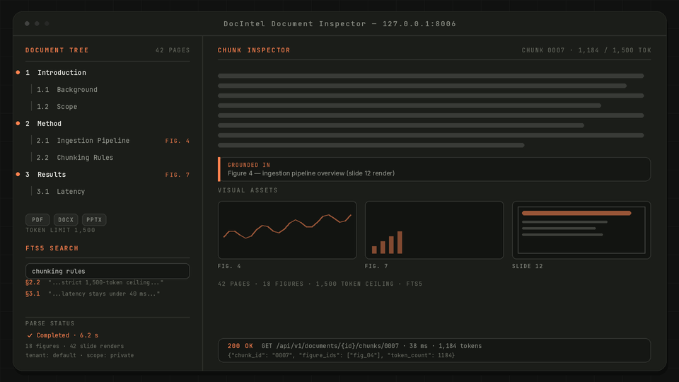

## Overview

HD2Lab Document Intelligence Service (DocIntel) is a standalone backend that turns unstructured documents into something an agent can navigate. Rather than flattening a report or deck into one long string of text, it parses PDF, DOCX, and PPTX files into a document tree that keeps the reading order, the heading hierarchy, the paragraphs, the tables, and the figures in their original relationship.

That structure is what makes the service useful to an AI agent. AGCore (AGPilot0005) does not need the whole document in its context window: it asks for an outline, opens the one section that matters, reads a single bounded chunk, and pulls the figure that the paragraph refers to — one tool call at a time, within a known token budget.

This profile describes the service at an architecture level. The implementation source is kept in its own application repository and is not linked from TechnicalHub.

## Runtime Architecture

Documents arrive through a streaming upload endpoint with a 100 MB limit and are registered as a parse job, so the caller never waits on a synchronous conversion. The job moves through `queued`, `processing`, `completed`, and `failed` states, and a recovery path picks up jobs whose worker stopped mid-run.

Processing then runs in four stages:

1. **Ingestion and parser dispatch** detects the format and streams the file into the matching parser — PyMuPDF for PDF, python-docx for DOCX, python-pptx for PPTX — under per-job resource limits.
2. **Hierarchy engine** builds the chapter → section → paragraph → table/figure tree, preserving reading order and section boundaries instead of relying on visual position alone.
3. **Token-aware chunking** cuts content at heading and sentence boundaries with a hard ceiling of 1,500 tokens per chunk, then records which section and which figures each chunk belongs to.
4. **Rendering and asset extraction** stores the embedded images and tables as assets and renders each page or slide to an image, so a chart that loses meaning in text can still be retrieved and shown.

The results are written to a document store with an FTS5 full-text index, and a REST query server reads from it. Every read is scoped by service token, tenant, owner, and access scope.

## Document Hierarchy and Grounding

The tree is the service's central data structure. Each section knows its parent, its children, its paragraph order, and the figure identifiers that appear inside it; each figure keeps its caption, its source page or slide, and the asset it was extracted from. A paragraph that discusses a chart is therefore linked to the chart itself, not to a text description of it.

Chunking respects the same structure. A chunk never crosses an unrelated heading, never stops mid-sentence, and never exceeds 1,500 tokens; Korean and English text are both handled, which matters for documents that mix both. A chunk carries its section identifier and figure references, so an answer built from it can point back to the exact place in the original file.

Slide decks get the same treatment: each slide is parsed for shape geometry and text, embedded images are extracted individually, and the slide itself is rendered at a defined DPI ceiling so a rendered page can be returned instead of a lossy summary.

## Demonstration

The view above is a rendering of the inspector screen: a parsed slide deck on the left with its section tree and figure references, and a single chunk on the right with its token count, its grounding reference, and the visual assets extracted from the document. It illustrates the inspection views and the shape of a query response rather than reproducing a specific processed file.

## Query API Contracts

Reads are served under `/api/v1/documents` and require a service token in `Authorization: Bearer <token>` (or `X-Service-Token`), together with `X-Tenant-Id`, `X-Owner-Id`, and an access scope.

- `POST /api/v1/documents` — streaming upload (100 MB limit) and asynchronous parse job creation.
- `GET /api/v1/documents/{id}` and `/status` — metadata and parse progress.
- `GET /api/v1/documents/{id}/outline` — the hierarchical table of contents, paginated with `limit` and `offset`.
- `GET /api/v1/documents/{id}/sections/{section_id}` — one section's body plus its figure identifiers.
- `GET /api/v1/documents/{id}/chunks/{chunk_id}` — a single chunk, guaranteed to be within the token ceiling.
- `GET /api/v1/documents/{id}/figures/{figure_id}` and `/figures/{figure_id}/asset` — figure metadata, caption, and the original or rendered image binary.
- `GET /api/v1/documents/{id}/manifest` — the asset catalogue for the document.
- `POST /api/v1/documents/{id}/search` — FTS5 keyword search with snippet highlighting.

The authorization model is intentionally quiet about what it protects: a missing or mismatched token returns `401`, a document owned by another tenant returns `404` rather than confirming that it exists, and a private document owned by another user in the same tenant returns `403`.

## Licensing and Privacy

PyMuPDF and its extraction add-on are licensed under AGPL v3, or under a commercial licence for proprietary closed deployments. DocIntel is architected so that obligation stays contained: the service is a separate process reached only over REST, it is not linked into AGCore or into calling applications, and the parser layer sits behind an interface that allows the PDF backend to be replaced — for example with a permissive engine under a commercial licence — without changing the API contract or the document model.

Documents themselves are private data. Content, rendered pages, and extracted assets are stored per tenant and owner, returned only within the caller's access scope, and never required to leave the deployment to satisfy a query. This profile publishes only the architecture and the interface contract; implementation source, internal storage layout, and any processed document content are not reproduced here.
