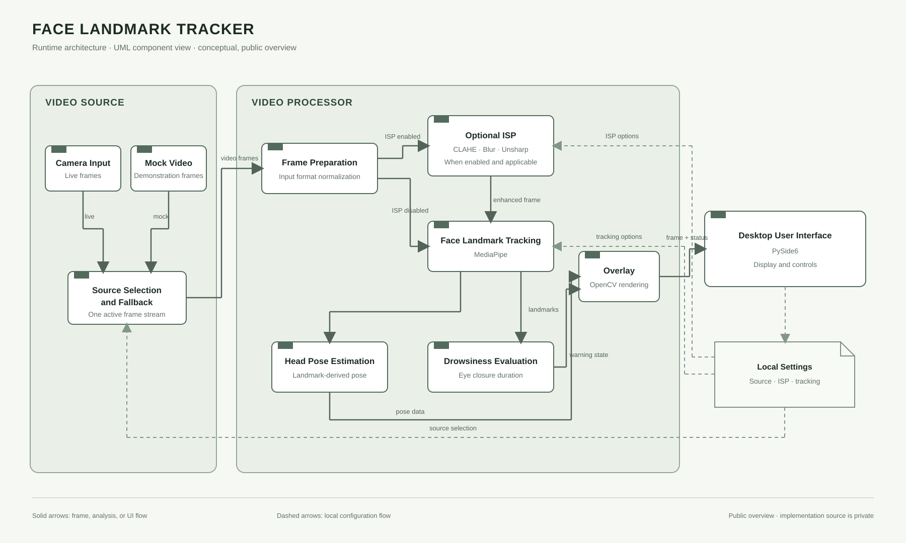
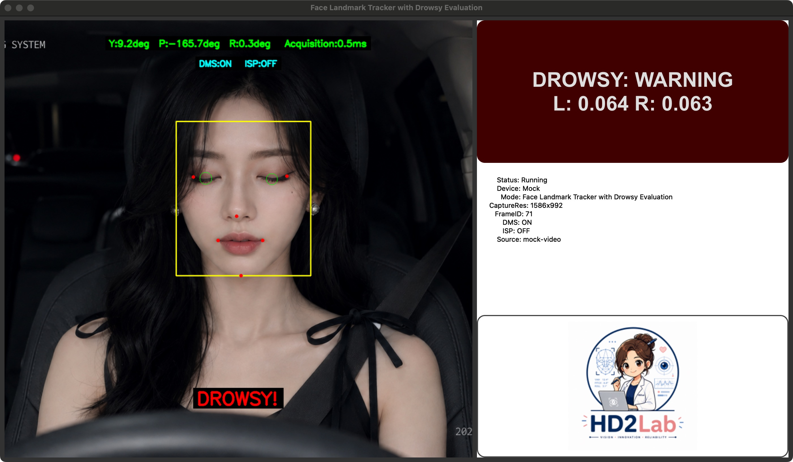

## Overview

Face Landmark Tracker is a desktop application for facial landmark tracking and drowsiness-warning demonstrations. It accepts a live camera or mock video source, processes frames, estimates head pose, and presents analysis results in a desktop interface.

The implementation project is private. This profile describes the approved technical overview and does not include source code or a link to the private repository.

## Runtime Architecture

The diagram shows a public-facing UML component view. It summarizes the data flow without exposing private implementation details.

### Processing flow

1. **Video Source** selects a live camera or mock video input and provides one active frame stream, with fallback behavior.
2. **Frame Preparation** normalizes frames for downstream processing.
3. **Optional ISP** can apply CLAHE, blur, or unsharp processing when enabled and applicable. When disabled, frames bypass this stage.
4. **Face Landmark Tracking** provides landmarks used by head pose estimation and drowsiness evaluation.
5. **Overlay Rendering** combines the video with analysis results and warning status for display in the PySide6 interface.

Local settings control the source and processing options. The diagram is a conceptual overview, not a deployment or source-level design.

## Demonstration

The following capture shows the application running with mock video and drowsiness monitoring enabled. The warning appears after the closed-eye condition is held during the demonstration.

This is a functional demonstration capture, not a claim about real-world accuracy or safety performance.

## Privacy

The implementation source is private. This profile publishes only a high-level technical introduction, approved architecture diagram, and demonstration image.
