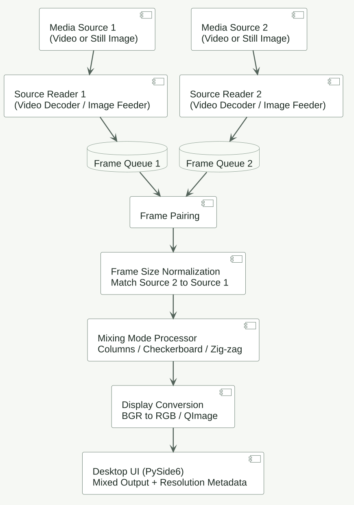
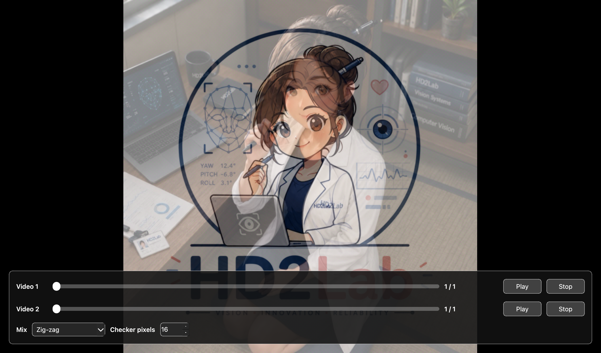

## Overview

General Purpose Video/Image Mixer is a desktop application that combines two video or still-image sources in real time. Users can choose a mixing pattern and adjust the checker-board tile size.

The implementation project is private. This profile presents a technical overview, a public-facing architecture diagram, and an approved demonstration capture without publishing source code or a repository link.

## Runtime Architecture

The UML component view uses general input names and summarizes the runtime data flow without exposing private implementation details.

1. **Media inputs** accept one video or still image per source.
2. **Source readers** decode video frames or feed still-image frames into separate queues.
3. **Frame mixing** pairs available frames, matches the secondary input to the reference frame size, and applies the selected mixing pattern.
4. **Display output** converts the mixed frame for the PySide6 interface and presents resolution metadata.

## Mixing Modes

- **Odd/Even Columns** alternates source pixels by column.
- **Checker-board** alternates image tiles; the tile size is adjustable.
- **Zig-zag** applies a diagonal alternating mask and combines selected BGR channels from the secondary input.

## Demonstration

The application capture shows two still-image inputs combined with Zig-zag mixing and the mode controls visible.

The image demonstrates the application interface and mixing output; it does not represent a performance or accuracy benchmark.

## Privacy and Limitations

The implementation source remains private. This public profile contains only the approved overview, high-level architecture, and demonstration image. It does not include source code or a link to the private repository.
